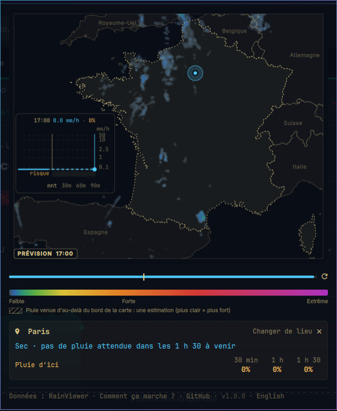

# Rain Radar France

Un widget de barre pour [Omarchy](https://omarchy.org) qui répond à une seule
question : **va-t-il pleuvoir ici, et quand ?**



Un clic sur le widget ouvre une carte de France avec la dernière heure de
radar, prolongée par une prévision des 90 minutes suivantes. Choisissez un
lieu : le panneau dit ce qui y tombe et ce qui arrive (« Pluie faible en ce
moment · sec d'ici ~1 h »), avec le risque de pluie à 30 minutes, 1 heure et
1 h 30.

C'est un portage pour la France de
[Rain Radar Denmark](https://github.com/diegogardini/omarchy-rain-radar-denmark-widget)
de diegogardini : la prévision, le calcul du risque, le graphique et le
panneau sont les siens. Ce dépôt change la source radar, la carte, la liste
des lieux et la langue.

Données : [RainViewer](https://www.rainviewer.com/), sans clé d'API. Sur la
France, sa mosaïque vient des radars de Météo-France.

## Comment ça marche

La prévision est une extrapolation radar : la pluie des dernières images est
déplacée dans la direction où elle allait depuis 30 minutes. Le risque de
pluie vient de 40 copies légèrement décalées de cette prévision. La méthode a
été choisie par le projet de recherche de l'auteur d'origine, qui a comparé
des méthodes de prévision sur six mois de radar danois :

- **[Comment ça marche ?](https://diegogardini.github.io/denmark-rain-nowcast/)** La version courte (en anglais).
- **[Le rapport complet](https://diegogardini.github.io/denmark-rain-nowcast/report.html)** Méthodes, preuves et limites.

## Ce qui n'a pas été vérifié pour la France

Les réglages (30 minutes d'historique, un seul vecteur de déplacement, la
dispersion des 40 copies) et les scores publiés par le projet d'origine ont
été mesurés **au Danemark**, sur le radar du DMI. Ils n'ont pas été remesurés
ici, et trois choses diffèrent :

- **Le relief.** Un seul vecteur pour toute la carte convient mal aux
  situations où la pluie ne se déplace pas d'un bloc : orages d'été, épisodes
  méditerranéens, Alpes et Pyrénées.
- **La source.** Les tuiles RainViewer donnent la réflectivité au dBZ près,
  à environ 1,7 km par pixel ; le widget en tire des mm/h par la relation de
  Marshall-Palmer. Elles ne distinguent pas « pas de pluie » de « hors de
  portée des radars ».
- **Les échos fixes.** Le widget danois masque les cellules où son radar voit
  de la pluie qui n'existe pas (éoliennes, bâtiments). Personne n'a mesuré ce
  masque pour la France : il est vide (`FixedEchoes.js`).

Comme toute extrapolation, elle déplace la pluie déjà visible au radar : elle
ne prévoit ni les averses qui se forment, ni celles qui grossissent ou
meurent. Elle est donc moins bonne au-delà de la première heure.

## Ce que l'on voit

- **La carte :** l'heure passée de radar (PASSÉ), puis la prévision
  (PRÉVISION, avec le contour de la France en pointillés fins), chacune avec
  son heure arrondie à 10 minutes. La pluie hachurée en gris vient
  d'au-delà du bord de la carte : c'est une estimation.
- **Le lieu :** **Ma position** (la position météo d'Omarchy, ou la position
  approximative de votre connexion une fois l'option activée), l'une des
  quatre plus grandes villes, la **recherche** (les 34 746 communes de France
  métropolitaine et de Corse, sans se soucier des accents ni des tirets), ou
  un clic sur la carte.
- **Le graphique** (sur le golfe de Gascogne) : la pluie au lieu choisi en
  mm/h, l'heure passée en trait plein et la prévision en pointillés, avec une
  bande orange pour le risque de pluie à chaque instant. Un clic dessus amène
  la carte à ce moment.
- **La carte de prévision :** la prévision en mots et les risques. Au sec :
  « Pluie d'ici » 30 min · 1 h · 1 h 30. Sous la pluie : « Sec pour de bon
  d'ici » 30 min · 1 h · 1 h 30.
- **La barre :** la pluie à votre lieu en ce moment (ou le maximum sur la
  France sans lieu) ; survol pour la prévision en mots, clic du milieu pour
  rafraîchir.
- **Français / English :** le lien à la fin du pied de page bascule la langue
  du panneau (français par défaut) et s'en souvient.

Tout est compté à partir de l'horloge, pas de l'image radar.

## Installation

Rien d'autre à installer sur un Omarchy standard : les tuiles radar sont lues
par un petit script Python qui n'utilise que la bibliothèque standard
(`helpers/radar-convert.py`).

```bash
omarchy plugin add https://github.com/SoaOaoS/omarchy-rain-radar-france-widget.git --enable
```

Mise à jour et suppression :

```bash
omarchy plugin update io.github.soaoaos.omarchy-rain-radar-france-widget
omarchy plugin remove io.github.soaoaos.omarchy-rain-radar-france-widget
```

La version s'affiche en bas du panneau ; les changements sont dans
[CHANGELOG.md](CHANGELOG.md).

## Réglages

- **Intervalle de rafraîchissement du radar :** 5 à 30 min, 10 par défaut.
- **Lancer l'animation à l'ouverture :** activé par défaut.

## Licence et données

Code : [MIT](LICENSE), © diegogardini pour le widget d'origine. Radar :
RainViewer, selon ses [conditions d'utilisation](https://www.rainviewer.com/api.html)
(usage personnel, source citée) ; le widget télécharge quatre tuiles toutes
les 10 minutes. Contours des pays : Natural Earth (domaine public). Communes
(`Towns.js`) : API Découpage administratif (INSEE, IGN),
[Licence Ouverte 2.0](https://www.etalab.gouv.fr/licence-ouverte-open-licence/).
Voir [MAP-SOURCES.md](MAP-SOURCES.md).

## Développement

```bash
omarchy plugin validate .
node --test tests/*.test.cjs
QT_QPA_PLATFORM=offscreen QT_QUICK_BACKEND=software /usr/lib/qt6/bin/qmltestrunner -input tests
bash tests/check-panel.sh   # un aperçu Quickshell avec des téléchargements simulés
```

`tools/` reconstruit les contours de la carte et la liste des communes à
partir de leurs sources.

Publication : augmenter la version dans `manifest.json`, ajouter l'entrée du
changelog, pousser sur `main` et taguer `vX.Y.Z` ; `omarchy plugin update`
tire `main`, donc chaque push y atteint les utilisateurs.
